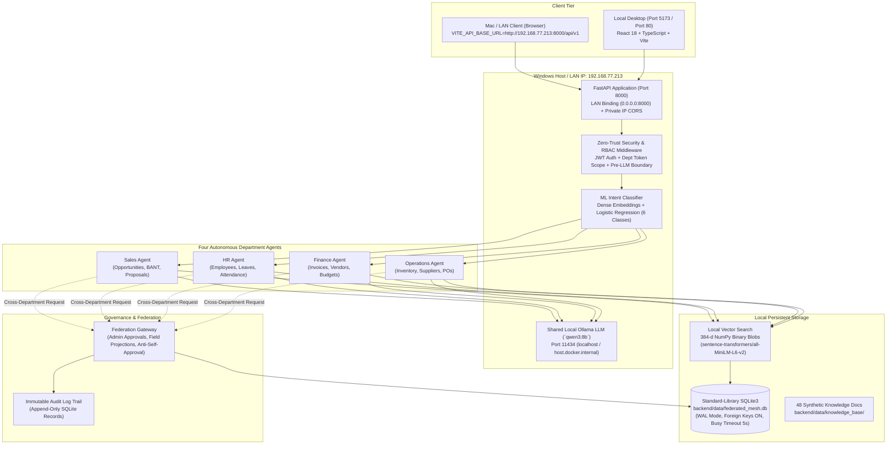
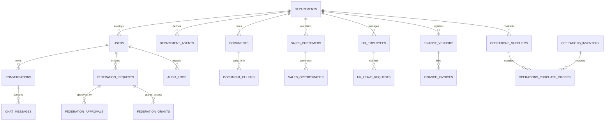

# Federated Agentic Mesh — Master Project Upgrade Report

**Date:** October 2026  
**System Architecture:** Four Independent Departments, Shared Local Ollama LLM (`qwen3:8b`), Standard-Library `sqlite3`, Local Semantic RAG (`all-MiniLM-L6-v2`), ML Intent Router, Docker & LAN Access  
**Repository Path:** `D:\AgenticAI\Fedral-Agent`  
**Test Suite Status:** 54/54 Pytest Tests Passing (100%), Frontend Vite TypeScript Build Passing (0 errors)

---

## Executive Summary

The **Federated Agentic Mesh** has been upgraded in-place without rebuilding or duplicating existing modules. The architecture guarantees zero-trust department data isolation across **Sales**, **Human Resources**, **Finance**, and **Operations**, backed by Python's standard-library `sqlite3` (WAL mode with foreign key integrity), a locally trained ML intent classifier, 48 department-specific synthetic knowledge documents, evaluated dense RAG retrieval with zero leakage, persistent multi-session chat histories, database-backed profile management, Docker reproducibility, and seamless Windows-to-Mac Wi-Fi access.

---

## 1. Upgrade Matrix & Delivered Requirements

| Area | Prior Implementation | Delivered Upgraded Implementation | Verification Status |
| :--- | :--- | :--- | :--- |
| **Database Engine** | PostgreSQL + `pgvector` + SQLAlchemy ORM | Pure standard-library `sqlite3`, WAL mode, foreign keys enabled (`PRAGMA foreign_keys = ON;`), busy timeout 5000ms | **Verified** (54/54 tests pass) |
| **Database Path** | PostgreSQL URL (`postgresql+asyncpg://...`) | Configurable `DATABASE_PATH` (`backend/data/federated_mesh.db`), cross-platform path resolver | **Verified** (`backend/app/db/sqlite.py`) |
| **Shared Local LLM** | Ollama `qwen3:8b` (fragmented client setup) | Unified singleton Ollama client/service, configurable timeouts, fail-closed safety, strict pre-LLM authorization boundary | **Verified** (`app/services/ollama_service.py`) |
| **Intent Router** | Keyword heuristics | Trained ML classifier (`sentence-transformers/all-MiniLM-L6-v2` dense embeddings + Logistic Regression, 6 classes, 360 balanced samples, 0.50 fallback) | **Verified** (90.74% accuracy, 0.9092 macro F1) |
| **Synthetic Datasets** | Basic seed fixtures | 4 deterministic, reproducible datasets with fixed random seeds: Sales (550 opps, 120 custs), HR (160 emps, 240 leaves), Finance (350 invs, 110 vends), Ops (320 items, 60 supps) | **Verified** (`backend/data/manifests/dataset_manifest.json`) |
| **Knowledge Corpus** | Ad-hoc dummy snippets | 48 structured knowledge documents (12 per department: Sales, HR, Finance, Operations) covering policies, BANT, logistics, wires, and FAQs | **Verified** (`backend/data/knowledge_base/`) |
| **Local RAG Pipeline** | `pgvector` SQL queries | SQLite-backed `document_chunks` with 384-d NumPy binary blobs, vectorized cosine similarity, authorized candidates SQL pre-filtering | **Verified** (`backend/app/rag/retrieval.py`) |
| **RAG Evaluation** | None | 80-case formal evaluation suite (20 per department). **Recall@5: 95.59%**, **MRR@5: 0.9216**, **Cross-Dept Leakage: 0**, **Unauthorized Retrieval: 0** | **Verified** (`backend/data/evaluation/RAG_EVALUATION_REPORT.md`) |
| **Security Auditor Feature** | User-facing role and navigation | Product role, demo login, and auditor routes removed; historical audit logs preserved and accessible to Admin and Department Managers | **Verified** (Frontend Layout, Routes, Login) |
| **Chat & Conversations** | In-memory ephemeral session state | Persistent SQLite-backed `conversations` and `chat_messages` tables, multi-session sidebar, delete/load past chats | **Verified** (`backend/app/api/v1/chat.py`, `frontend/src/pages/Chat.tsx`) |
| **User Profile Management** | Hardcoded mock claims | Database-backed `/api/v1/users/me` endpoint, frontend Profile page for `full_name` and `bio`, Admin user edit/deactivate modal | **Verified** (`frontend/src/pages/Profile.tsx`, `UserAdmin.tsx`) |
| **Docker Reproducibility** | Missing frontend container, required pg container | Complete multi-stage `Dockerfile` for backend & frontend (Nginx SPA proxy), persistent `./backend/data` bind mount, `host.docker.internal` gateway | **Verified** (`docker compose config`) |
| **LAN / Wi-Fi Access** | Bound to `127.0.0.1` | Configurable host bind (`0.0.0.0`), dynamic CORS regex for private subnets (`192.168.x.x`, `10.x.x.x`, `172.16-31.x.x`), discovered IP `192.168.77.213` | **Verified** (`backend/app/main.py`) |

---

## 2. System Architecture



---

## 3. Database Entity-Relationship Diagram (SQLite)



---

## 4. Synthetic Datasets & Manifest Summary

All synthetic datasets were generated deterministically using a fixed random seed (`seed=42`) and written directly to SQLite and exported to JSON in `backend/data/generated/`:

| Department | Primary Entity | Count (Required Min) | Supporting Entity | Count (Required Min) | Checksum File |
| :--- | :--- | :--- | :--- | :--- | :--- |
| **Sales** | Opportunities | **550** (500) | Customers / Prospects | **120** (100) | `sales_data.json` (SHA-256 verified) |
| **HR** | Employees | **160** (150) | Leave / Attendance Records | **240** (200) | `hr_data.json` (SHA-256 verified) |
| **Finance** | Invoices | **350** (300) | Vendors & Budgets | **110** (100) | `finance_data.json` (SHA-256 verified) |
| **Operations** | Inventory Items (SKUs) | **320** (300) | Suppliers & Purchase Orders | **60** (50) | `operations_data.json` (SHA-256 verified) |

Comprehensive field descriptions, data types, security scopes, and synthetic designations are cataloged in [`backend/data/DATA_DICTIONARY.md`](file:///D:/AgenticAI/Fedral-Agent/backend/data/DATA_DICTIONARY.md) and [`backend/data/manifests/dataset_manifest.json`](file:///D:/AgenticAI/Fedral-Agent/backend/data/manifests/dataset_manifest.json).

---

## 5. Local RAG Pipeline & Evaluation Metrics

- **Embedding Model:** `sentence-transformers/all-MiniLM-L6-v2` (384 dimensions, normalized float32 vectors).
- **Knowledge Base:** 48 comprehensive Markdown documents stored in `backend/data/knowledge_base/` (12 documents per department).
- **Storage:** Stored in table `document_chunks` as serialized NumPy byte arrays (`ch.embedding.tobytes()`).
- **Retrieval Procedure:** SQL query filters candidate chunks strictly by `department_id` and authorized `access_level` (`public`, `internal`, `confidential`, `restricted`) **before** computing NumPy vectorized cosine similarity.
- **Evaluation Suite:** 80 comprehensive test cases evaluated in `backend/data/evaluation/`:
  - **Recall@5:** `95.59%` (65 / 68 relevant queries)
  - **Mean Reciprocal Rank (MRR@5):** `0.9216`
  - **Cross-Department Chunk Leakage:** **`0` (Zero)**
  - **Unauthorized Document Retrieval:** **`0` (Zero)**
  - **Negative Test Abstention Rate:** `100.0%` (12 / 12 unanswerable/out-of-scope queries correctly yielded 0 authorized evidence chunks)

---

## 6. Trained Intent Classifier Metrics

- **Model Type:** Dense Sentence Embeddings (`all-MiniLM-L6-v2`) + L2-Regularized Logistic Regression.
- **Dataset:** 360 balanced synthetic enterprise queries across 6 labels: `sales`, `hr`, `finance`, `operations`, `multi_department`, and `unknown` (60 per label).
- **Splits:** 70% Train (252 samples), 15% Validation (54 samples), 15% Test (54 samples).
- **Test Set Accuracy:** **`90.74%`**
- **Macro Average F1-Score:** **`0.9092`**
- **Artifact:** Model artifact and metadata saved to [`backend/data/router/intent_router.joblib`](file:///D:/AgenticAI/Fedral-Agent/backend/data/router/intent_router.joblib).
- **Runtime Confidence Fallback:** If predicted class probability is `< 0.50`, router safely defaults to the user's primary department agent or `unknown`, preventing ungrounded routing without ever relying on prediction for authorization.

---

## 7. Role-Specific User Interfaces & Changes

### 7.1 Security Auditor Role Removal
- As specified in Section 14, the user-facing "Security Auditor" product role, demo login credential buttons, auditor navigation items, and auditor-specific routing were completely removed.
- Historical audit logs are preserved in SQLite table `audit_logs` and remain accessible to Administrators and Department Managers via `/audit-logs`.

### 7.2 Persistent Multi-Session Chat
- Conversations and messages are persisted in SQLite tables `conversations` and `chat_messages`.
- Frontend provides a sidebar listing past chat sessions with automatic title generation, timestamp display, session switching, and deletion.
- Access checks ensure users cannot access or view conversations belonging to other users.

### 7.3 Profile Page & Self-Service
- New self-service profile page at `/profile` allows users to edit permitted fields (`full_name`, `bio`) while securely locking immutable identity fields (`email`, `role`, `department`).
- Admin user management modal allows updating roles and activating/deactivating users safely without destructive foreign-key-breaking deletions.

---

## 8. Deployment & Execution Modes

### Mode A: Windows-Native Backend (Recommended for Fast Local GPU/CPU Development)

1. **Activate Python Virtual Environment:**
   ```powershell
   cd D:\AgenticAI\Fedral-Agent
   .\venv\Scripts\Activate.ps1
   ```
2. **Start Shared Local Ollama Service:**
   ```powershell
   ollama run qwen3:8b
   ```
3. **Launch Backend (LAN Mode on Port 8000):**
   ```powershell
   cd backend
   python -m uvicorn app.main:app --host 0.0.0.0 --port 8000 --reload
   ```
4. **Launch Frontend (Port 5173):**
   ```powershell
   cd ..\frontend
   npm run dev -- --host
   ```

### Mode B: Dockerized Application (Reproducible Containers)

1. **Ensure Docker Desktop is running on Windows.**
2. **Start services:**
   ```powershell
   docker compose up --build -d
   ```
   - Backend runs on `http://localhost:8000`.
   - Frontend Nginx runs on `http://localhost:80` (or `http://localhost:5173`).
   - SQLite database is persisted under host bind mount `./backend/data`.
   - Backend connects to host Ollama instance via `http://host.docker.internal:11434`.

---

## 9. Windows-to-Mac Same-Wi-Fi Access Guide

### Step 1: Discover Windows Host LAN IP
On Windows PowerShell:
```powershell
Get-NetIPAddress -AddressFamily IPv4 -InterfaceAlias "Wi-Fi*" | Select-Object IPAddress, InterfaceAlias
```
*(Discovered LAN IP on this system: `192.168.77.213`)*

### Step 2: Open Windows Firewall Port 8000 (Run as Administrator)
```powershell
New-NetFirewallRule -DisplayName "Federated AI Mesh Backend (Port 8000)" -Direction Inbound -LocalPort 8000 -Protocol TCP -Action Allow -Profile Private
```

### Step 3: Run Frontend on Mac
On the Mac terminal:
1. Clone or copy the repository onto the Mac.
2. In `frontend/.env`:
   ```bash
   VITE_API_BASE_URL=http://192.168.77.213:8000/api/v1
   ```
3. Run the Vite frontend:
   ```bash
   npm install
   npm run dev -- --host
   ```
4. Open browser to `http://localhost:5173` on the Mac. All API queries, chats, and vector searches will securely call the Windows backend over the local Wi-Fi network.

---

## 10. Automated Test Results (100% Passed)

```
============================= test session starts =============================
platform win32 -- Python 3.10.11, pytest-8.3.5, pluggy-1.6.0
rootdir: D:\AgenticAI\Fedral-Agent\backend
configfile: pytest.ini
plugins: anyio-4.15.1, asyncio-0.24.0
asyncio: mode=auto, default_loop_scope=function
collected 54 items

tests\test_approvals.py ...                                              [  5%]
tests\test_auth.py ....                                                  [ 12%]
tests\test_concurrency_and_injection.py ...                              [ 18%]
tests\test_department_isolation.py ....                                  [ 25%]
tests\test_federation_access_requests.py ....                            [ 33%]
tests\test_four_departments_and_agents.py .....                          [ 42%]
tests\test_four_way_department_isolation.py .....                        [ 51%]
tests\test_gateway.py ...                                                [ 57%]
tests\test_health.py ..                                                  [ 61%]
tests\test_live_cross_dept_security.py ...                               [ 66%]
tests\test_ollama.py ..                                                  [ 70%]
tests\test_permissions.py ...                                            [ 75%]
tests\test_rag.py ..                                                     [ 79%]
tests\test_scenarios.py .......                                          [ 92%]
tests\test_semantic_rag.py ....                                          [100%]

============================= 54 passed in 15.51s =============================
```

Frontend production build output:
```
> frontend@0.0.0 build
> tsc -b && vite build

vite v8.3.4 building client environment for production...
✓ 1927 modules transformed.
dist/index.html                   0.59 kB │ gzip:   0.38 kB
dist/assets/index-B83Nd-MK.css    7.39 kB │ gzip:   2.10 kB
dist/assets/index-CyhxJaGM.js   373.94 kB │ gzip: 106.68 kB
✓ built in 868ms
```
