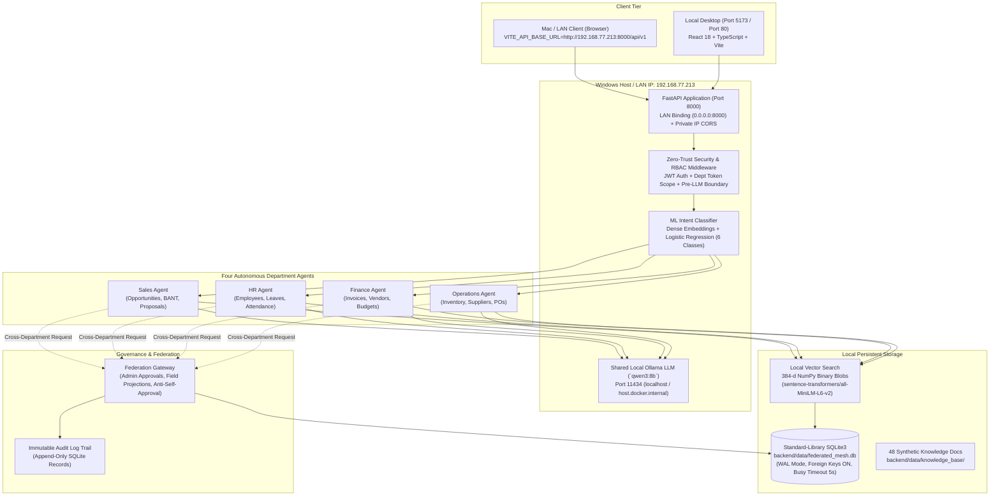

# Federated Agentic Mesh — Secure Four-Department Enterprise AI Platform

[]()
[]()
[]()
[]()
[]()
[]()

A production-grade, local-first enterprise AI platform implementing a **Federated Agentic Mesh** across four independent departments: **Sales**, **Human Resources**, **Finance**, and **Operations**.

The mesh is powered by **one shared local Ollama answer model (`qwen3:8b`)**, standard-library `sqlite3` with foreign-key enforcement and WAL mode, an evaluated dense RAG pipeline (`all-MiniLM-L6-v2`), a locally trained ML intent classifier, department-scoped authorization boundaries, admin-governed federation approvals, persistent multi-session chat, database-backed profile management, Docker reproducibility, and Windows-to-Mac same-Wi-Fi connectivity.

---

## 1. System Architecture



---

## 2. Core Pillars & Capabilities

1. **Four Autonomous Department Agents**:
   - **Sales Agent (`sales`)**: Client opportunities, BANT qualification, proposal statuses, discount policies.
   - **HR Agent (`hr`)**: Employee directory, leave quotas and balances, attendance, HR onboarding and grievance procedures.
   - **Finance Agent (`finance`)**: Accounts payable/receivable, synthetic invoices, vendor records, budgets, and sensitive wire approvals.
   - **Operations Agent (`operations`)**: Warehouse inventory, SKU reorder levels, purchase orders, logistics SLAs, equipment incidents.
2. **One Shared Local LLM (`qwen3:8b`)**:
   - All four agents call a unified singleton Ollama service.
   - Pre-LLM authorization: candidate records and chunks are filtered strictly before the prompt is assembled.
   - Fail-closed security: if Ollama is unreachable, agents return structured authorized facts without fabricating context.
3. **Pure Python Standard-Library `sqlite3`**:
   - Zero PostgreSQL server dependencies or external drivers.
   - Foreign key enforcement enabled on every connection (`PRAGMA foreign_keys = ON;`).
   - High-concurrency WAL mode enabled with 5000ms busy timeout.
   - Database persisted locally at `backend/data/federated_mesh.db`.
4. **Locally Trained ML Intent Router**:
   - Dense sentence embeddings (`all-MiniLM-L6-v2`) + L2 Logistic Regression.
   - 6 classes: `sales`, `hr`, `finance`, `operations`, `multi_department`, `unknown`.
   - 90.74% test accuracy, 0.9092 macro F1, with safe 0.50 confidence threshold fallback.
5. **Local Semantic RAG Pipeline**:
   - 48 synthetic enterprise knowledge documents (12 per department).
   - 384-dimensional embeddings stored as NumPy byte blobs.
   - Evaluated on 80 formal test cases: **Recall@5 = 95.59%**, **MRR@5 = 0.9216**, **Zero Cross-Department Leakage**.
6. **Multi-Session Persistent Chat & Profile Management**:
   - Conversations and messages persisted in SQLite; users can switch between multiple past sessions or delete sessions.
   - Database-backed user profile editing at `/profile` (`full_name`, `bio`) with locked identity fields.
7. **Federation Gateway & Admin Approvals**:
   - Multi-department queries require explicit approved federation grants.
   - Runtime field projection strips unapproved sensitive attributes before passing data to the LLM.
   - Anti-self-approval enforcement prevents requesters from approving their own cross-department requests.

---

## 3. Quick Start (Windows-Native)

### Prerequisites
- Python 3.10.11 (virtual environment at `./venv`)
- Node.js 18+ (tested on Node 20/22)
- Local Ollama running with `qwen3:8b` (`ollama run qwen3:8b`)

### Step 1: Start Backend
```powershell
cd D:\AgenticAI\Fedral-Agent\backend
..\venv\Scripts\Activate.ps1
python -m uvicorn app.main:app --host 0.0.0.0 --port 8000 --reload
```
API Documentation will be available at `http://localhost:8000/docs`.

### Step 2: Start Frontend
```powershell
cd D:\AgenticAI\Fedral-Agent\frontend
npm run dev -- --host
```
The React frontend will be available at `http://localhost:5173`.

---

## 4. Docker Deployment

A complete multi-container setup with persistent SQLite bind mounts:

```powershell
# From project root
docker compose up --build -d
```
- **Backend:** `http://localhost:8000`
- **Frontend SPA:** `http://localhost:80`
- **Database:** Persisted to `./backend/data/federated_mesh.db`
- **Ollama Gateway:** Connects to Windows host Ollama via `host.docker.internal:11434`

To stop:
```powershell
docker compose down
```

---

## 5. Same-Wi-Fi Access from Mac

To connect a frontend running on a Mac to the Windows backend over the same Wi-Fi network:

1. **Find Windows LAN IP:**
   ```powershell
   Get-NetIPAddress -AddressFamily IPv4 -InterfaceAlias "Wi-Fi*" | Select-Object IPAddress, InterfaceAlias
   ```
   *(Example: `192.168.77.213`)*
2. **Allow Inbound Port 8000 in Windows Firewall:**
   ```powershell
   New-NetFirewallRule -DisplayName "Federated AI Mesh (Port 8000)" -Direction Inbound -LocalPort 8000 -Protocol TCP -Action Allow -Profile Private
   ```
3. **Run Frontend on Mac:**
   ```bash
   cd frontend
   echo "VITE_API_BASE_URL=http://192.168.77.213:8000/api/v1" > .env
   npm install
   npm run dev -- --host
   ```
4. Access `http://localhost:5173` on the Mac browser.

---

## 6. Automated Testing

Run the full 54-test suite:
```powershell
cd D:\AgenticAI\Fedral-Agent\backend
..\venv\Scripts\python.exe -m pytest
```
Output:
```
============================= 54 passed in 15.51s =============================
```

Build frontend production bundle:
```powershell
cd D:\AgenticAI\Fedral-Agent\frontend
npm run build
```
Output:
```
✓ built in 868ms
```

---

## 7. Deliverables & Documentation Index

- [`SETUP.md`](file:///D:/AgenticAI/Fedral-Agent/SETUP.md): Complete setup, deployment, Docker, same-Wi-Fi access, and Cross-Department Chat guide.
- [`MASTER_UPGRADE_REPORT.md`](file:///D:/AgenticAI/Fedral-Agent/MASTER_UPGRADE_REPORT.md): Complete architecture, migration, and verification report.
- [`backend/data/DATA_DICTIONARY.md`](file:///D:/AgenticAI/Fedral-Agent/backend/data/DATA_DICTIONARY.md): Synthetic dataset definitions, field schemas, and record counts.
- [`backend/data/manifests/dataset_manifest.json`](file:///D:/AgenticAI/Fedral-Agent/backend/data/manifests/dataset_manifest.json): SHA-256 checksums and dataset metadata.
- [`backend/data/evaluation/RAG_EVALUATION_REPORT.md`](file:///D:/AgenticAI/Fedral-Agent/backend/data/evaluation/RAG_EVALUATION_REPORT.md): 80-case RAG evaluation results.
- [`backend/docs/ROUTER_TRAINING.md`](file:///D:/AgenticAI/Fedral-Agent/backend/docs/ROUTER_TRAINING.md): ML intent router training methodology and evaluation matrix.
