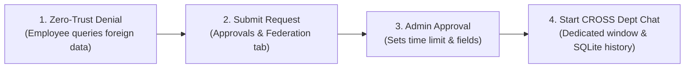

# Federated Agentic Mesh — Complete Setup & Deployment Guide

Welcome to the **Federated Agentic Mesh**, a production-grade, local-first enterprise AI platform implementing autonomous departmental agents (**Sales**, **Human Resources**, **Finance**, and **Operations**), standard-library `sqlite3` in WAL mode, local dense semantic RAG, a trained ML intent classifier, zero-trust cross-department federation, persistent multi-session chat, and a shared local Ollama LLM (`qwen3:8b`).

---

## 1. System Requirements & Prerequisites

Before starting, ensure your machine has the following installed:

| Component | Minimum Version | Recommended Version | Notes |
| :--- | :--- | :--- | :--- |
| **Operating System** | Windows 10/11, macOS, Linux | Windows 11 / macOS 14+ | Windows native includes automated `.bat` launchers |
| **Python** | Python 3.10.x | Python 3.10.11 | Must be Python 3.10 for virtual environment compatibility |
| **Node.js** | Node.js 18.x | Node.js 20.x or 22.x LTS | Bundled with `npm` |
| **Ollama** | Latest | Latest | Local LLM runtime serving `qwen3:8b` |
| **RAM** | 8 GB | 16 GB+ | 8 GB model (`qwen3:8b`) runs smoothly on modern CPU/GPU |
| **Optional: Docker** | Docker Engine 24+ | Docker Desktop 4.30+ | For containerized multi-service deployment |

---

## 2. Quick Start (Windows-Native One-Click Launcher)

If you are on Windows, the repository provides pre-configured automation scripts:

### Step 1: Start All Services
Double-click [`start.bat`](file:///d:/AgenticAI/Fedral-Agent/start.bat) or run from PowerShell:
```powershell
.\start.bat
```
This script automatically:
1. Verifies the Python 3.10 virtual environment in `.\venv`.
2. Detects your local LAN / Wi-Fi IP address for cross-device access.
3. Initializes the SQLite database and generates synthetic department datasets if missing.
4. Checks the local Ollama daemon and runs `qwen3:8b` if not already running.
5. Launches the **FastAPI Backend** on port `8000` (bound to `0.0.0.0`).
6. Launches the **React Vite Frontend** on port `5173` (`--host`).
7. Opens your default browser to `http://localhost:5173`.

### Step 2: Stop All Services
To cleanly terminate all running background servers, double-click [`stop.bat`](file:///d:/AgenticAI/Fedral-Agent/stop.bat) or run:
```powershell
.\stop.bat
```

---

## 3. Manual Step-by-Step Setup Guide

Follow these steps for a complete manual installation from scratch.

### Step 1: Clone the Repository & Navigate to Project Root
```powershell
cd D:\AgenticAI\Fedral-Agent
```

---

### Step 2: Configure Python Virtual Environment
Create and activate a virtual environment using Python 3.10:

```powershell
# Create virtual environment named venv
python -m venv venv

# Activate on Windows PowerShell:
.\venv\Scripts\Activate.ps1

# Activate on Windows CMD:
.\venv\Scripts\activate.bat

# Activate on macOS / Linux:
source venv/bin/activate
```

---

### Step 3: Install Backend Dependencies
Install all required packages from `requirements.txt`:

```powershell
python -m pip install --upgrade pip
pip install -r requirements.txt
```

> [!NOTE]
> The platform uses Python's standard-library `sqlite3` with Write-Ahead Logging (WAL mode) and foreign keys enabled. **No PostgreSQL, pgvector, or external database servers are required.**

---

### Step 4: Configure Environment Variables
Copy the example environment file to `.env`:

```powershell
# Copy at project root
Copy-Item .env.example .env

# Copy for backend directory
Copy-Item backend\.env.example backend\.env
```

Review your `backend/.env` file:
```ini
APP_NAME="Federated Agentic Mesh"
APP_ENV=development
APP_HOST=0.0.0.0
APP_PORT=8000
LAN_MODE=true
DEBUG=false
API_V1_STR=/api/v1

# SQLite Database (Standard-Library sqlite3)
DATABASE_PATH=data/federated_mesh.db

# Security & JWT
JWT_SECRET_KEY=b2c896503f8485292eb5f3c96644f1074e5033878b66858e8e78077d704ba41c
JWT_ALGORITHM=HS256
ACCESS_TOKEN_EXPIRE_MINUTES=60

# Local Ollama AI Model
OLLAMA_BASE_URL=http://127.0.0.1:11434
ANSWER_MODEL=qwen3:8b
OLLAMA_TIMEOUT_SECONDS=120
OLLAMA_TEMPERATURE=0.1
OLLAMA_TOP_P=0.9

# Local Embeddings (Sentence Transformers)
EMBEDDING_PROVIDER=sentence_transformers
EMBEDDING_MODEL=sentence-transformers/all-MiniLM-L6-v2
EMBEDDING_DIMENSION=384
ALLOW_MODEL_DOWNLOADS=false

# Intent Router Model & Data Directories
ROUTER_MODEL_PATH=data/router/intent_router.joblib
DATA_DIR=data
UPLOAD_DIR=data/uploads
MAX_UPLOAD_SIZE_MB=10

# Human Approvals & Self-Approval Prevention
APPROVAL_EXPIRY_MINUTES=60
PREVENT_SELF_APPROVAL=true
```

---

### Step 5: Initialize Database, Knowledge Corpus & Intent Router

Run the initialization scripts to generate synthetic datasets, build knowledge vectors, and train the local intent router:

```powershell
cd D:\AgenticAI\Fedral-Agent\backend

# 1. Generate 4 reproducible synthetic datasets (seed=20260421)
..\venv\Scripts\python.exe scripts/generate_synthetic_datasets.py

# 2. Seed departments, users, and business records into SQLite
..\venv\Scripts\python.exe scripts/import_synthetic_to_sqlite.py

# 3. Generate 48 department knowledge documents (12 per department)
..\venv\Scripts\python.exe scripts/generate_knowledge_corpus.py

# 4. Chunk & embed knowledge documents with 384-d vectors in SQLite
..\venv\Scripts\python.exe scripts/index_knowledge_corpus.py

# 5. Generate 360 balanced query samples & train ML intent router
..\venv\Scripts\python.exe scripts/generate_router_dataset.py
..\venv\Scripts\python.exe scripts/train_intent_router.py
```

---

### Step 6: Install & Start Ollama Local LLM

1. Download and install Ollama from [ollama.com](https://ollama.com).
2. Open a terminal and pull the local `qwen3:8b` model:
   ```powershell
   ollama pull qwen3:8b
   ```
3. Run the model:
   ```powershell
   ollama run qwen3:8b
   ```
4. Verify Ollama is responding:
   ```powershell
   curl http://127.0.0.1:11434/api/tags
   ```

---

### Step 7: Install Frontend Dependencies

Open a new terminal window:
```powershell
cd D:\AgenticAI\Fedral-Agent\frontend
npm install
```

---

### Step 8: Launch Application Services

#### Terminal 1: FastAPI Backend
```powershell
cd D:\AgenticAI\Fedral-Agent\backend
..\venv\Scripts\Activate.ps1
python -m uvicorn app.main:app --host 0.0.0.0 --port 8000 --reload
```
- API Base: `http://localhost:8000`
- Swagger Documentation: `http://localhost:8000/docs`
- Health Probe: `http://localhost:8000/health/ready`

#### Terminal 2: React Vite Frontend
```powershell
cd D:\AgenticAI\Fedral-Agent\frontend
npm run dev -- --host
```
- Web Application: `http://localhost:5173`

---

## 4. Docker Deployment (Multi-Container Setup)

To deploy the entire platform reproducibly using Docker Compose:

```powershell
# From project root
docker compose up --build -d
```

### Container Endpoints:
- **Frontend SPA (Nginx):** `http://localhost:80` (or `http://localhost:3000`)
- **FastAPI Backend:** `http://localhost:8000`
- **Database:** Persisted to `./backend/data/federated_mesh.db`
- **Ollama Gateway:** Automatically routes to the host machine's Ollama service via `host.docker.internal:11434`.

To shut down containers:
```powershell
docker compose down
```

---

## 5. Same-Wi-Fi Access from Mac or Mobile Clients

To access the Windows backend from a Mac, laptop, or mobile browser on the same Wi-Fi network:

### Step 1: Open Inbound Port 8000 on Windows Firewall
Run [`enable_lan_firewall.bat`](file:///d:/AgenticAI/Fedral-Agent/enable_lan_firewall.bat) as Administrator, or execute in PowerShell (Admin):
```powershell
New-NetFirewallRule -DisplayName "Federated AI Mesh (Port 8000)" -Direction Inbound -LocalPort 8000 -Protocol TCP -Action Allow -Profile Private
```

### Step 2: Discover Host LAN IP
```powershell
Get-NetIPAddress -AddressFamily IPv4 -InterfaceAlias "Wi-Fi*" | Select-Object IPAddress, InterfaceAlias
```
*(Example: `192.168.77.213`)*

### Step 3: Access from Client Browser
- The Vite dev server (`http://<WINDOWS_LAN_IP>:5173`) automatically proxies API requests to `http://127.0.0.1:8000`, eliminating firewall blocks for external clients.
- Simply open your Mac or mobile browser to:
  ```text
  http://<WINDOWS_LAN_IP>:5173
  ```

---

## 6. Cross-Department Access & "CROSS Dept Chat" Feature Guide

The Federated Agentic Mesh enforces zero-trust data boundaries between **Sales**, **HR**, **Finance**, and **Operations**.

### The 4-Step Cross-Department Lifecycle:



1. **Pre-Request Denial:**
   - When an employee (e.g. Sales) queries records from another department (e.g. Finance invoices), access is denied with a zero-trust policy notice prompting the user to request access.
2. **Submit Federation Request:**
   - Navigate to the **Approvals & Federation** tab.
   - Click **`New Request`**. Select target department, business purpose, requested fields (e.g. `invoice_number, client_name, status`), and duration (e.g. 60 minutes).
3. **Administrator Approval:**
   - Log in as Administrator (`admin@mesh.enterprise.internal`).
   - In the **Approvals & Federation** tab under **Federation Access Requests**, review the request and click **`Approve Grant`**.
4. **Launch "CROSS Dept Chat":**
   - Once approved, the requesting user sees a prominent **`Start CROSS Dept Chat`** button on their approved request card.
   - Clicking it creates a dedicated conversation titled:
     ```
     CROSS Dept Chat: FINANCE (#<GRANT_ID>)
     ```
   - The user is navigated directly into this dedicated window.
   - A specialized header displays: `CROSS Dept Chat • FINANCE Scope (Federated Access Session)`.
   - In the sidebar, the session is highlighted with a purple **`CROSS`** badge.
   - All questions, grounded answers, and retrieved evidence are **permanently saved in SQLite chat history**.
   - **Zero-Trust Safety:** Confidential attributes (such as employee compensation/salaries and unapproved banking numbers) remain strictly protected and masked.
   - When the grant expires or is revoked, queries in this window immediately return to the denied state.

---

## 7. Default Demo Accounts & Roles

The system is seeded with enterprise demo accounts for testing all access boundaries:

| Department | Role | Email | Password | Scope & Privileges |
| :--- | :--- | :--- | :--- | :--- |
| **Enterprise Governance** | Administrator | `admin@mesh.enterprise.internal` | `MeshSecure2026!` | Full mesh orchestration, approvals, user management |
| **Sales** | Sales Manager | `sales.manager@mesh.enterprise.internal` | `MeshSecure2026!` | Sales opportunities, BANT pipeline, discount approvals |
| **Sales** | Sales Representative | `sales.rep@mesh.enterprise.internal` | `MeshSecure2026!` | Sales deals, customer accounts, standard discounts |
| **HR** | HR Director | `hr.manager@mesh.enterprise.internal` | `MeshSecure2026!` | Employee directory, leave balances, sensitive salaries |
| **HR** | HR Specialist | `hr.specialist@mesh.enterprise.internal` | `MeshSecure2026!` | Employee directory, leave requests (salaries masked) |
| **Finance** | Finance Controller | `finance.manager@mesh.enterprise.internal` | `MeshSecure2026!` | Invoices, vendor payables, budgets, wire approvals |
| **Operations** | Operations Lead | `ops.manager@mesh.enterprise.internal` | `MeshSecure2026!` | Inventory SKUs, reorder thresholds, supplier POs |
| **Operations** | Operations Specialist | `ops.specialist@mesh.enterprise.internal` | `MeshSecure2026!` | Warehouse stock, item locations, purchase orders |

> [!TIP]
> The login page features **One-Click Quick Select** buttons for each of the accounts listed above.

---

## 8. Verification & Automated Testing

### 1. Run Live HTTP Server Verification
```powershell
cd D:\AgenticAI\Fedral-Agent\backend
..\venv\Scripts\python.exe scripts/verify_server.py
```
Verifies `/health`, `/health/ready`, and `/docs`.

### 2. Run End-to-End Mesh Lifecycle Verification
```powershell
cd D:\AgenticAI\Fedral-Agent\backend
..\venv\Scripts\python.exe scripts/verify_four_mesh_e2e.py
```
Verifies all 4 agents, boundary isolation, and the complete Federation Access Request lifecycle.

### 3. Run Pytest Suite
```powershell
cd D:\AgenticAI\Fedral-Agent\backend
..\venv\Scripts\python.exe -m pytest
```

### 4. Build Frontend Production Bundle
```powershell
cd D:\AgenticAI\Fedral-Agent\frontend
npm run build
```
Builds the production bundle into `frontend/dist/` in under 2 seconds.

---

## 9. Troubleshooting & FAQ

### Q1: `LLMServiceUnavailableError` — Ollama is not responding
- Make sure Ollama is running: execute `ollama run qwen3:8b` in a terminal.
- Test endpoint: `curl http://127.0.0.1:11434/api/tags`.
- If running in Docker, ensure `OLLAMA_BASE_URL=http://host.docker.internal:11434`.

### Q2: Port 8000 or Port 5173 is already in use
- Check which process is occupying the port:
  ```powershell
  Get-Process -Id (Get-NetTCPConnection -LocalPort 8000).OwningProcess
  ```
- Terminate with `stop.bat` or kill the PID:
  ```powershell
  Stop-Process -Id <PID> -Force
  ```

### Q3: How do I reset the SQLite database to factory defaults?
Simply delete `backend/data/federated_mesh.db` (and any `-wal` / `-shm` companion files) and re-run:
```powershell
cd D:\AgenticAI\Fedral-Agent\backend
..\venv\Scripts\python.exe scripts/import_synthetic_to_sqlite.py
..\venv\Scripts\python.exe scripts/index_knowledge_corpus.py
```

### Q4: Database WAL mode companion files (`.db-wal`, `.db-shm`)
SQLite WAL (Write-Ahead Logging) creates temporary `-wal` and `-shm` files alongside `federated_mesh.db`. This is expected behavior that allows high concurrency without read-write locking conflicts.

